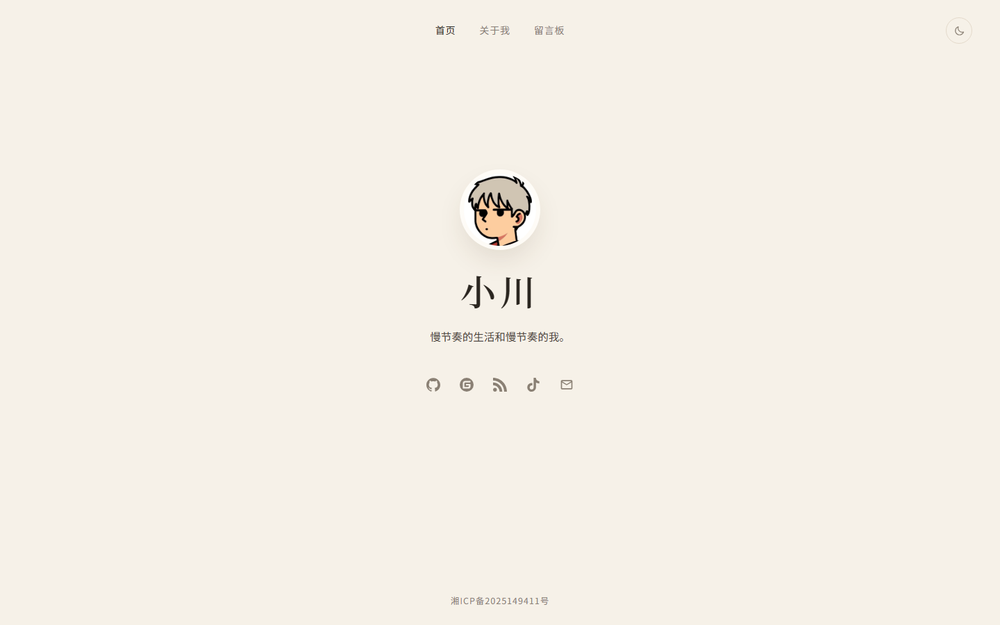
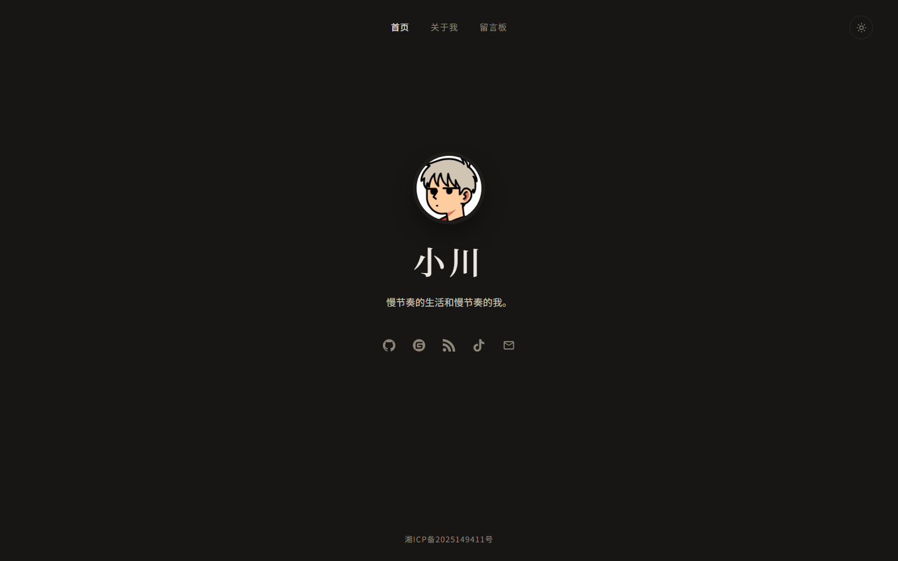
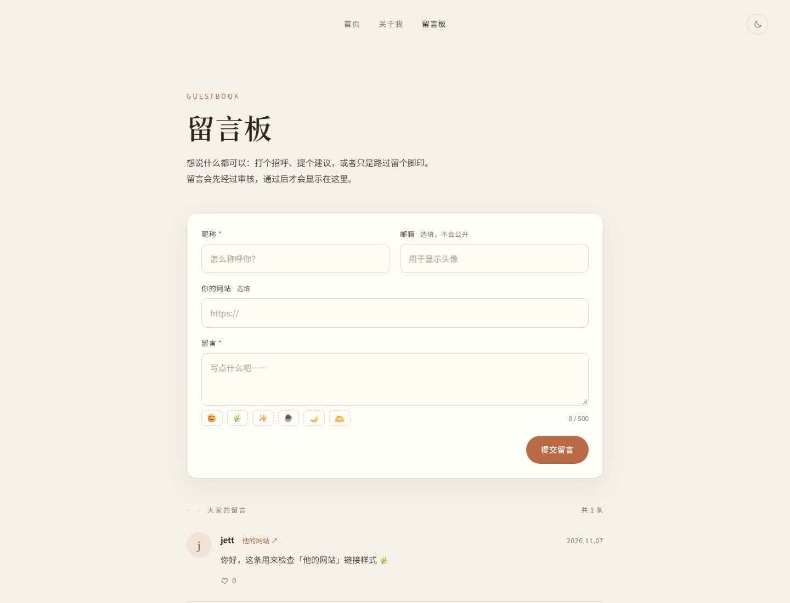
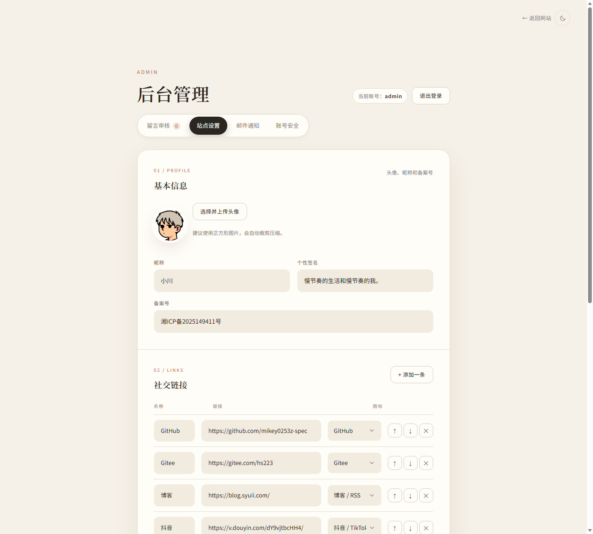
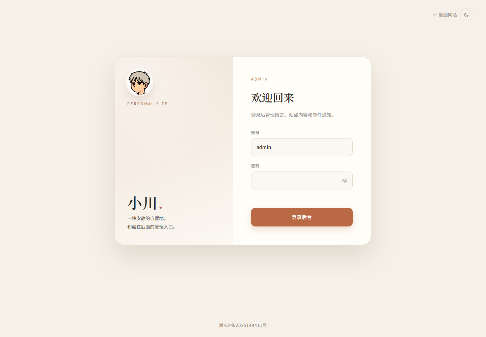
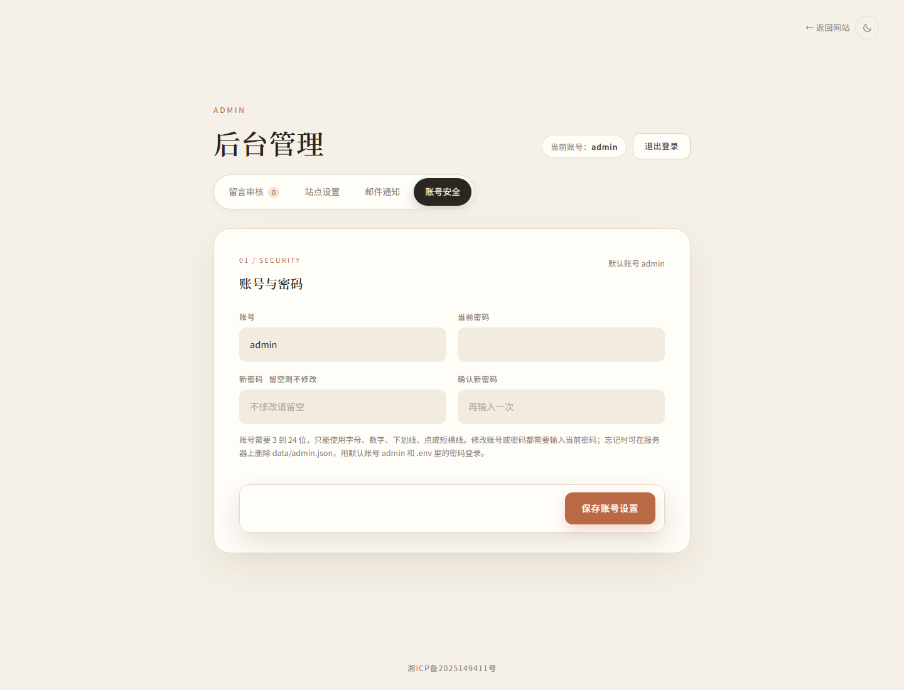
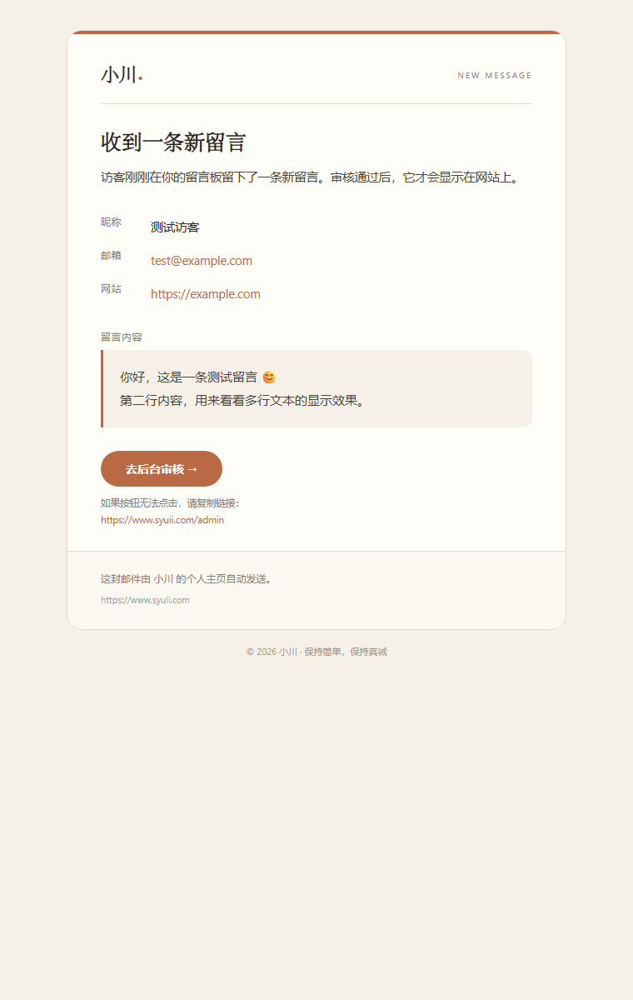

# 小川的个人主页

一个暖调极简风格的个人主页：单屏居中的个人名片、关于我、留言板，以及一套完整的站点管理后台。

- 在线预览：https://www.syuii.com
- 技术栈：Node.js + Express + 原生 HTML / CSS / JavaScript
- 数据存储：JSON 文件，不需要数据库
- 管理后台：留言审核、站点设置、邮件通知、账号安全
- 支持浅色 / 深色主题，响应式布局


## 功能

### 前台

- **首页名片**：头像、昵称、个性签名、社交链接（图标可选 GitHub / Gitee / 微博 / B站 / 知乎 / X / 博客 / 抖音 / 邮箱等）
- **关于我**：小标题、标题、副标题、分段正文
- **留言板**：昵称、邮箱（不公开）、个人网站、正文、表情、点赞、站长回复
- **浅色 / 深色**：右上角切换，默认跟随系统，并记住选择
- **响应式**：手机、平板、桌面都能正常浏览

### 留言审核

- 访客提交后进入「待审核」，页面上会明确提示需要等待审核
- 后台支持 通过 / 拒绝 / 退回待审核 / 回复 / 删除
- 只有「已通过」的留言才会公开显示
- 同一条留言每个 IP 每天只能点赞一次

### 站点管理后台

访问 `/admin`，默认账号 `admin`，初始密码来自 `.env` 的 `ADMIN_PASSWORD`。

- **站点设置**：上传头像（自动裁剪压缩、同步更新 favicon）、昵称、签名、备案号、社交链接增删排序、关于页文案
- **邮件通知**：配置 SMTP，有新留言时发提醒邮件，支持发送测试邮件
- **账号安全**：修改后台账号和密码（scrypt 加盐哈希存储）

### 邮件提醒

访客提交留言后，如果已开启邮件通知，站长会收到一封与网站同风格的提醒邮件，包含留言内容、访客信息和「去后台审核」按钮。

## 预览

| 首页（浅色） | 首页（深色） |
| --- | --- |
|  |  |

| 留言板 | 管理后台 |
| --- | --- |
|  |  |

| 后台登录 | 账号安全 |
| --- | --- |
|  |  |

| 新留言提醒邮件 |
| --- |
|  |

## 快速开始

需要 Node.js 18 或更高版本。

```bash
git clone https://github.com/mikey0253z-spec/xiaochuan-homepage.git
cd xiaochuan-homepage

npm install

cp .env.example .env
# Windows PowerShell: Copy-Item .env.example .env

# 修改 .env，至少设置 ADMIN_PASSWORD
npm start
```

打开：

- 网站：http://localhost:3000
- 后台：http://localhost:3000/admin

开发时可用 `npm run dev`（修改后端代码自动重启）。

### 运行测试

先启动服务，再执行：

```bash
npm test
```

如果修改过后台密码，测试时带上：

```bash
ADMIN_PASSWORD=你的密码 npm test
```

## 环境变量

复制 `.env.example` 为 `.env`：

| 变量 | 说明 | 默认 |
| --- | --- | --- |
| `PORT` | 服务端口 | `3000` |
| `ADMIN_PASSWORD` | 后台初始密码 | `admin123456`（请务必修改） |
| `SESSION_SECRET` | 会话签名密钥 | 留空会自动生成并保存在 `data/.session-secret` |

`.env`、`data/*.json`、`data/.session-secret`、`node_modules/` 都已在 `.gitignore` 中排除，不会提交到仓库。

## 后台使用

登录 `/admin` 后有四个标签：

1. **留言审核**：处理访客留言
2. **站点设置**：头像、昵称、签名、社交链接、关于页、备案号
3. **邮件通知**：SMTP 配置和新留言提醒
4. **账号安全**：修改后台账号和密码

首次登录后建议立刻：

- 修改后台账号和密码
- 填写站点设置
- 配置邮件通知并发送测试邮件

### QQ 邮箱 SMTP 示例

| 配置项 | 填写 |
| --- | --- |
| SMTP 服务器 | `smtp.qq.com` |
| 端口 | `465` |
| SSL / TLS | 勾选 |
| SMTP 账号 | 你的 QQ 邮箱 |
| SMTP 密码 | 邮箱设置里生成的「授权码」，不是登录密码 |
| 接收提醒的邮箱 | 你常用的邮箱 |

163 邮箱用 `smtp.163.com`，端口 `465`，勾选 SSL，密码同样填授权码。

## 目录结构

```text
.
├─ views/                  页面模板（服务端注入站点设置）
│  ├─ index.html
│  ├─ about.html
│  ├─ guestbook.html
│  ├─ admin.html
│  └─ 404.html
├─ public/
│  └─ assets/
│     ├─ css/style.css
│     ├─ js/site.js
│     ├─ js/guestbook.js
│     ├─ js/admin.js
│     └─ img/              头像、favicon 等
├─ server/
│  ├─ admin.js             账号密码存储与校验
│  ├─ auth.js              后台登录会话
│  ├─ icons.js             社交图标库
│  ├─ mailer.js            邮件模板与发送
│  ├─ render.js            页面模板渲染
│  ├─ site.js              站点设置存储
│  ├─ store.js             留言存储
│  └─ util.js              校验、限流等
├─ data/                   运行时数据（不在仓库中）
├─ tests/smoke.mjs         接口冒烟测试
├─ docs/preview/           README 预览图
├─ server.js               服务入口
└─ package.json
```

## 数据与备份

所有数据都在服务器本地文件里：

| 文件 | 内容 |
| --- | --- |
| `data/messages.json` | 留言 |
| `data/site.json` | 站点设置、SMTP 配置 |
| `data/admin.json` | 后台自定义账号和密码哈希（改过账号后才生成） |
| `data/.session-secret` | 会话签名密钥 |
| `public/assets/img/` | 头像、favicon 等上传图片 |

备份 `data/` 和 `public/assets/img/` 即可。仓库里的 `data/` 只有 `.gitkeep`，部署后需要重新在后台填写站点设置和邮件配置。

## 部署

### 通用 Node.js 部署

```bash
git clone https://github.com/mikey0253z-spec/xiaochuan-homepage.git
cd xiaochuan-homepage
npm install --omit=dev
cp .env.example .env
vi .env   # 设置 PORT 和 ADMIN_PASSWORD

node server.js
```

生产环境建议用 PM2 或 systemd 托管：

```bash
npm i -g pm2
pm2 start server.js --name xiaochuan
pm2 save
pm2 startup
```

### 宝塔面板部署

1. 软件商店安装 **Node.js 版本管理器**，选择 Node 18 或更高
2. 把代码放到 `/www/wwwroot/xiaochuan`
3. 安装依赖并配置：

```bash
cd /www/wwwroot/xiaochuan
npm install --omit=dev
cp .env.example .env

# 写入配置（把密码换成你自己的）
printf '%s\n' 'PORT=3000' 'ADMIN_PASSWORD=你的强密码' 'SESSION_SECRET=' > .env

chown -R www:www /www/wwwroot/xiaochuan
chmod 600 .env
```

4. 宝塔「网站 → Node 项目」添加项目：
   - 项目目录：`/www/wwwroot/xiaochuan`
   - 启动文件：`server.js`
   - 端口：`3000`
5. 添加站点并配置反向代理：
   - 目标 URL：`http://127.0.0.1:3000`
   - **发送域名（Host）：`$host`**（不要用 `127.0.0.1`，否则邮件里的后台链接会指向 localhost）
6. 申请 SSL，开启强制 HTTPS
7. 域名 A 记录解析到服务器公网 IP
8. 访问 `https://你的域名/admin`，登录后重新填写站点设置和邮件配置

> 3000 端口不需要对公网放行，统一走 Nginx 的 80 / 443。  
> 运行用户是 `www` 时，务必执行 `chown -R www:www`，否则后台保存设置或留言时会因为 `data/` 无写权限而报错。

## 更新网站

本地修改后：

```bash
git add .
git commit -m "update: ..."
git push origin main
git push gitee main
```

服务器上：

```bash
cd /www/wwwroot/xiaochuan
git pull
```

然后重启 Node 项目，或：

```bash
pm2 restart xiaochuan
```

`.env`、`data/`、上传的头像都不会被覆盖。

## 安全说明

- 首次部署后立刻修改 `ADMIN_PASSWORD`，并在后台「账号安全」里改掉默认账号
- 后台尽量只通过 HTTPS 访问，不要直接暴露 3000 端口
- SMTP 授权码保存在服务器 `data/site.json`，不要把这个文件公开
- 已内置：留言限流、登录限流、蜜罐字段、输入长度校验、邮箱不公开、前端 XSS 防护、scrypt 密码哈希
- `data/admin.json` 删除后会回退到 `admin` + `.env` 的 `ADMIN_PASSWORD`

## 常见问题

**后台提示账号或密码不正确？**

- 默认账号是 `admin`
- 密码来自 `.env` 的 `ADMIN_PASSWORD`；如果服务启动时没读到 `.env`，会回退到 `admin123456`
- 修改 `.env` 后需要重启 Node 服务
- 忘记密码：删除服务器上的 `data/admin.json`，重启后用 `admin` + `.env` 密码登录

**收不到邮件？**

- 先点「发送测试邮件」
- QQ / 163 邮箱要用「授权码」，不是登录密码
- 端口 465 勾选 SSL，587 不勾选
- 检查垃圾箱，以及服务器是否能访问外网 SMTP

**保存设置或留言报错？**

```bash
chown -R www:www /www/wwwroot/xiaochuan
```

**改了样式但页面没变化？**

静态资源已加版本号，正常情况下刷新即可；必要时强制刷新（Ctrl / Cmd + F5），或确认服务已重启。

**端口被占用？**

```bash
lsof -i:3000
# 或
ss -lntp | grep 3000
```

## License

[MIT](LICENSE)

## 致谢

- 社交图标来自 [Simple Icons](https://simpleicons.org/) 与 [Material Design Icons](https://materialdesignicons.com/)
- 头像使用站点主人提供的图片
